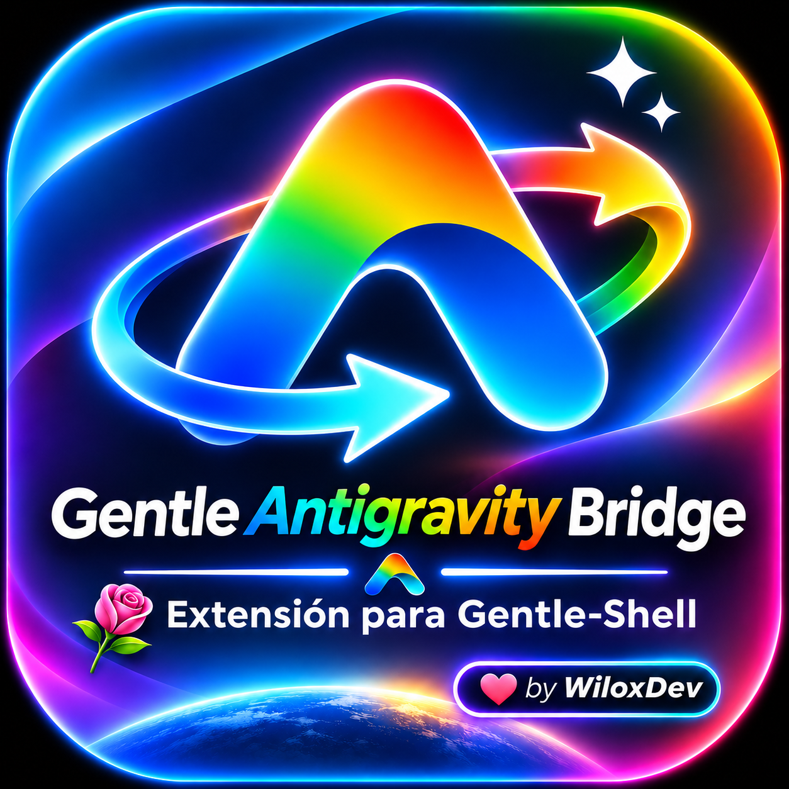

<p align="center">
  
</p>

# Gentle Antigravity Bridge

[](https://gentlemanprogramming.com/gentle-hub/)
[](https://bit.ly/48zTJUo)
[](LICENSE)
[](https://pi.dev)

Puente nativo y de latencia ultra baja para **Gentle Shell** y **Pi** que conecta directamente con los modelos de **Google Antigravity / Cloud Code Assist** mediante OAuth 2.0 PKCE y Server-Sent Events (SSE).

> 💬 **Comunidad y Soporte:** `wilox2` · [Servidor de Discord Oficial](https://bit.ly/48zTJUo)

Puente de Google Antigravity para Gentle Shell y Pi: Gemini 3.8/3.7/3.6, Claude Sonnet/Opus 4.6 y GPT-OSS | Nativo Gentle-Shell & Pi | 💡 **Rotación Multi-Cuenta:** En caso de tener dos o más cuentas de Google, dispones de conmutación automática ante límites 429 para distribuir el consumo y evitar agotamiento de cuotas.

Te permite usar **Gemini**, **Claude** (Sonnet 4.6, Opus 4.6) y **GPT-OSS** aprovechando tu suscripción activa de Google (Google AI Pro / Cloud Code Assist) con **tarifa plana, sin pagar por token y sin descargar binarios externos pesados de 1.5 GB**.

---

## 🌟 Características Destacadas

- **Multimodelo en una sola suscripción:** Acceso unificado a Gemini (3.8/3.7/3.6/3.5 Flash, 3.1 Pro) y Claude (Sonnet 4.6, Opus 4.6) servido por Google Vertex/Antigravity.
- **Cero dependencias y Cero binarios:** No requiere instalar el CLI `agy` ni el servidor ACP de Google. Conexión HTTP/SSE pura directa con TLS prewarm y keep-alive.
- **Telemetría para Gentle Shell:** Reporta el porcentaje consumido de tu ventana móvil de 5 horas y ventana semanal a la barra inferior de Gentle Shell y al panel de uso.
- **Comandos simplificados `/agy`:** Diagnósticos instantáneos con `/agy doctor`, visor de cuota con `/agy quota` y gestión multicuenta con `/agy accounts`.
- **Conmutación Automática (Failover):** Si una cuenta agota su cuota de 5 horas (HTTP 429), conmuta automáticamente a la siguiente cuenta vinculada en caliente.
- **Carga de Reglas Locales:** Respeta e inyecta automáticamente los archivos `AGENTS.md`, `.claude/rules/*.md` y `CLAUDE.md`.
- **Respaldo Local CPAMC / CLIProxyAPI:** Detecta y ofrece enlace con tu proxy local en `127.0.0.1:8317` en caso de contingencia.

---

## 📦 Instalación

> 🤖 **Para Instalación Asistida por AI (Claude, Pi, Cursor):** Consulta estrictamente [AI_INSTALL.md](AI_INSTALL.md). Este paquete es un **Proveedor Headless**, NO debe generar widgets en chat.

### En Gentle Shell
```bash
# Vía npm (cuando esté publicado):
gentle-shell install npm:gentle-antigravity-bridge

# O desde una ruta local / git:
gentle-shell install /home/wilsonlavio/projects/gentle-antigravity-bridge
```

### En Pi Puro
```bash
pi install /home/wilsonlavio/projects/gentle-antigravity-bridge
```

---

## 🚀 Uso Rápido

1. **Inicia sesión con tu cuenta de Google:**
   ```bash
   pi
   # Dentro de Pi ejecuta:
   /login antigravity
   ```
   *(Se abrirá tu navegador para confirmar con Google. En entornos SSH remotos, puedes pegar la URL de redirección directamente).*

2. **Verifica la salud de la conexión:**
   ```text
   /agy doctor
   ```

3. **Selecciona tu modelo favorito:**
   Escribe `/model` y selecciona cualquiera de los modelos bajo el namespace `gentle-antigravity/`:
   - `gentle-antigravity/gemini-3.8-flash` (Equilibrio de velocidad, razonamiento y 1M de contexto)
   - `gentle-antigravity/gemini-3.7-flash` (Excelente para refactors y codificación general)
   - `gentle-antigravity/gemini-3.1-pro` (Capacidad analítica profunda)
   - `gentle-antigravity/claude-sonnet-4-6` (Claude Sonnet provisto por tu cuenta Google)
   - `gentle-antigravity/claude-opus-4-6` (Claude Opus con thinking nativo)
   - `gentle-antigravity/gpt-oss-120b` (Modelo Open Source de OpenAI vía Antigravity)

---

## 🩺 Comandos Integrados (`/agy` o `/antigravity`)

- `/agy doctor` — Chequeo integral de latencia, validez de tokens OAuth, suscripción activa y reglas de proyecto.
- `/agy quota` — Visualización gráfica de las ventanas de cuota (5h y semanal) con tiempo exacto para el reinicio.
- `/agy models` — Lista todos los modelos disponibles en el catálogo con sus límites de contexto.
- `/agy accounts` — Lista y permite alternar entre múltiples cuentas de Google vinculadas.
- `/agy refresh` — Fuerza la sincronización dinámica del catálogo con los servidores de Google.
- `/agy rules` — Muestra las reglas de proyecto detectadas activas.

---

## 💡 Escalado a Producción: CPAMC y Auto Switcher Pro

Para un uso personal o tareas directas en tu máquina local, **Gentle Antigravity Bridge** te brinda conexión directa de latencia cero.

Sin embargo, si realizas **trabajo continuo e intenso con agentes autónomos** o manejas múltiples cuentas de Google, la combinación de **CLI Proxy API Management Center (CPAMC)** y **Auto Switcher Pro** ([WiloxDev/cpamc-auto-switcher-pro](https://github.com/WiloxDev/cpamc-auto-switcher-pro)) es la solución definitiva recomendada:

1. **Rotación Continua e Invisible:** Cuando una cuenta alcanza el límite de la ventana de 5 horas (HTTP 429), Auto Switcher Pro conmuta a cuentas de reserva en segundo plano sin interrumpir la generación de código.
2. **Pools Soberanos Multi-Proveedor:** Permite agrupar en una sola cola tus cuentas de **Google Antigravity**, **Claude Pro/Max**, **OpenAI Codex** y **NVIDIA NIM**, balanceando la carga según disponibilidad de tokens.
3. **Protección Anti-Agotamiento:** Si las cuotas de Google bajan del umbral crítico, CPAMC enruta automáticamente peticiones a modelos gratuitos de respaldo (como DeepSeek R1 o Llama 3.3 en NVIDIA NIM) hasta que la ventana de cuota se restablezca.

---

## 🏷️ Temas de GitHub para Gentle Hub

Para que el catálogo de **Gentle Hub** reconozca e indexe esta extensión:
- `gentle-hub-project`
- `gentle-shell`
- `gentle-shell-package`
- `gentle-shell-extension`
- `pi-extension`
- `pi-package`
- `antigravity`
- `gemini`
- `claude`

---

## 📄 Licencia

MIT © Wilox.
